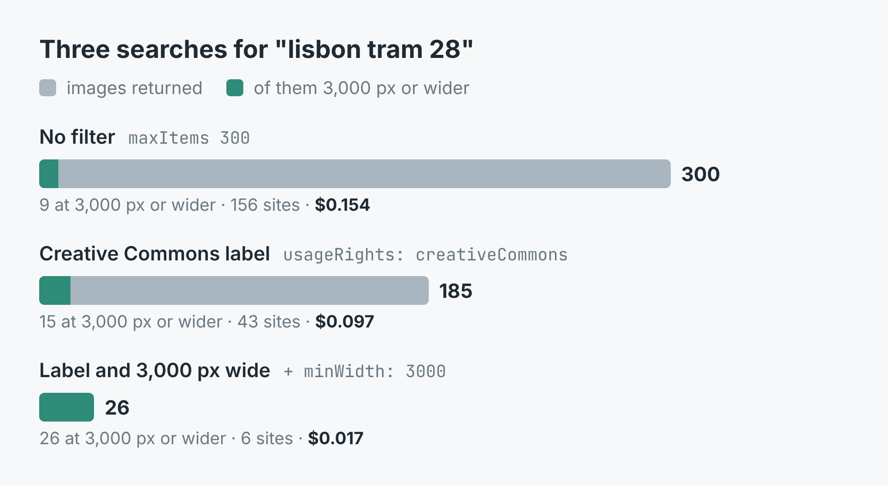
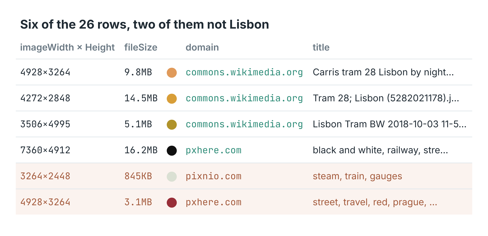

# Google Images scraper

Google Images results for a search, one row per image, in a CSV: the
full-size image address on the site that hosts it, its width and height, the
file size, the page it appears on and the site's name. Filter to Google's
Creative Commons label and drop everything under a minimum width.

These scripts call [Google Images Scraper](https://apify.com/simple.actor/google-images)
on Apify, which reads Google's Images tab with its Tools-menu filters (size,
colour, type, file type, time, usage rights) and an exact size floor of its own.



The write-up, with three real runs for Lisbon's Tram 28, is
[How to find Creative Commons photos big enough to print](https://simple-actor.github.io/creative-commons-photos-big-enough-to-print-lisbon-tram-28/).

## Run it

You need an [Apify](https://apify.com) account and its API token, from
Console → Settings → API & Integrations.

**Node** (18 or newer):

```bash
cd node
npm install
APIFY_TOKEN=your_token LICENCE=cc MIN_WIDTH=3000 node images.mjs "lisbon tram 28"
```

**Python** (3.11 or newer):

```bash
cd python
python -m venv .venv && . .venv/bin/activate
pip install -r requirements.txt
APIFY_TOKEN=your_token LICENCE=cc MIN_WIDTH=3000 python images.py "lisbon tram 28"
```

The search is whatever follows the script name; Google's operators work
(`site:commons.wikimedia.org`, `"exact phrase"`, `-word`). Three settings:

- `LICENCE=cc` asks for Google's Creative Commons label. Leave it out for
  every licence.
- `MIN_WIDTH` drops images narrower than that many pixels, measured on
  Google's stated width. Leave it out for no floor.
- `MAX_IMAGES` (default 100) is how many images to return. Google has
  roughly 300 to 400 for most searches.

Both scripts print the first ten images and write `images.csv`. With
`MAX_IMAGES=5`:

```
  4272x2848  commons.wikimedia.org  File:Tram 28; Lisbon (5282021178).jpg - Wikimedia
  3024x4032  commons.wikimedia.org  File:The Iconic Tram 28 Lisbon, Portugal.jpg - Wik
  4928x3264  commons.wikimedia.org  File:Carris tram 28 Lisbon by night.jpg - Wikimedi
  3264x4928  commons.wikimedia.org  File:Carris tram 28 Lisbon.jpg - Wikimedia Commons
  5184x3456  commons.wikimedia.org  File:Tram 28 and Tuk-tuk taxis in Lisbon.jpg - Wik
5 image(s) for "lisbon tram 28" -> images.csv
```

## What a row looks like



[`sample-output.json`](sample-output.json) holds four real rows from the run
with the label and the 3,000-pixel floor. The fields you will use most:

| Field | What it holds |
|---|---|
| `imageUrl` | The full-size image on the site that hosts it, not Google's copy |
| `imageWidth`, `imageHeight` | Its size in pixels, as Google states it |
| `pageUrl` | The page the image appears on: where to check its licence |
| `title`, `sourceName`, `domain` | The page's title, the site's name and its host |
| `fileSize`, `dominantColor` | The file's size and the image's dominant colour |
| `thumbnailUrl` | Google's thumbnail |
| `imageId` | Google's ID for the image, stable across runs, for merging runs |

A search that could not be read is a row of its own with `type: "error"`,
`error` and `errorDescription`, and the run itself stays green. Both scripts
print those rows and leave them out of the CSV.

## Cost

$0.0005 per image, plus $0.004 for each search that returned images and
$0.00005 for the run start, Apify's platform costs included. A search Google
has no images for is not charged. In the post, 300 unfiltered images were
$0.154, the 185 with the Creative Commons label $0.097, and the 26 with the
label and the floor $0.017.

## Limits

- The Creative Commons label is Google's, not a licence. Check the licence on
  `pageUrl` before reusing an image.
- Filters don't check the subject: 3 of the 26 Tram 28 images were of Porto,
  Prague and a steam train's gauges.
- Google's results move between runs. Run a search twice and merge on
  `imageId` if you need everything it has.
- With `MIN_WIDTH` set, a search reads on only while it keeps at least seven
  images for every page of Google's results read, so a very high floor
  returns only a few.
